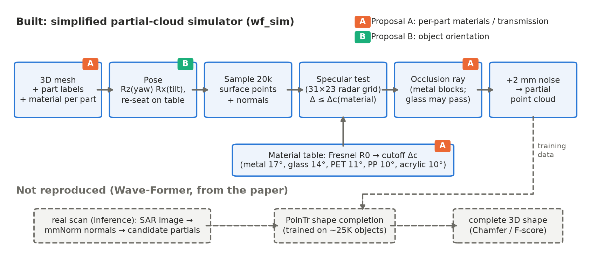
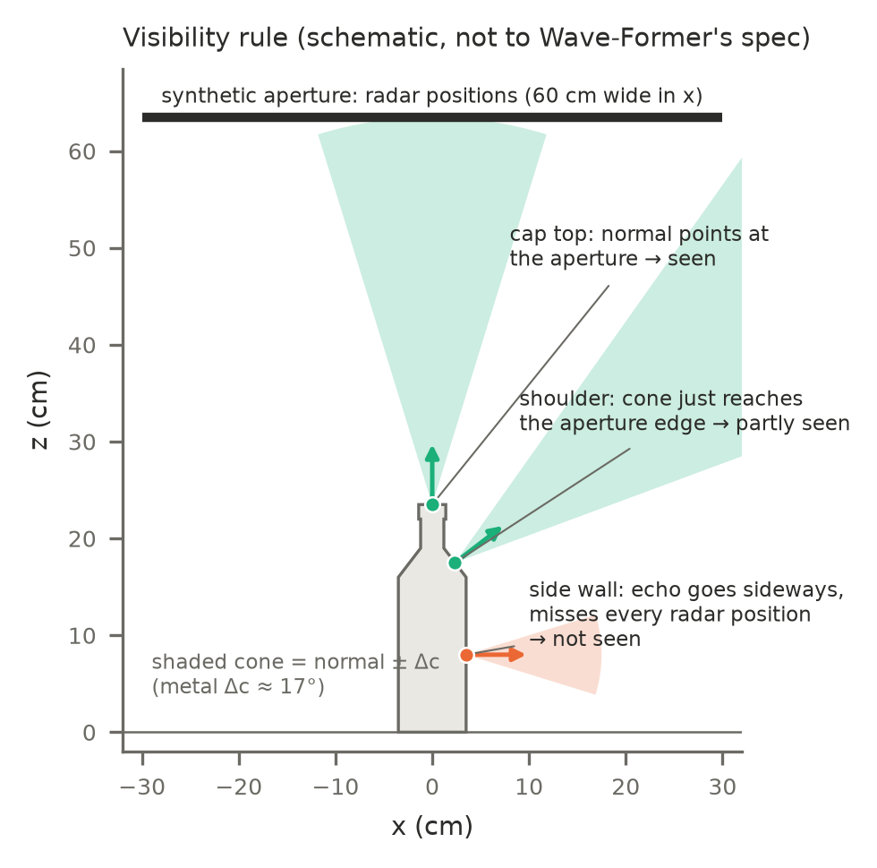
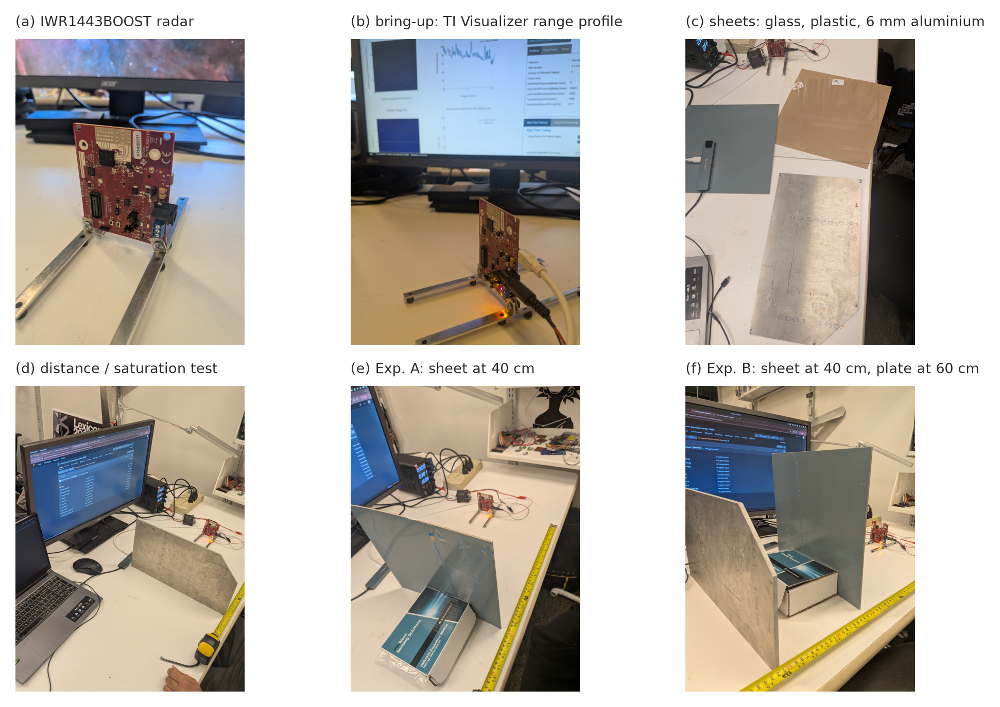
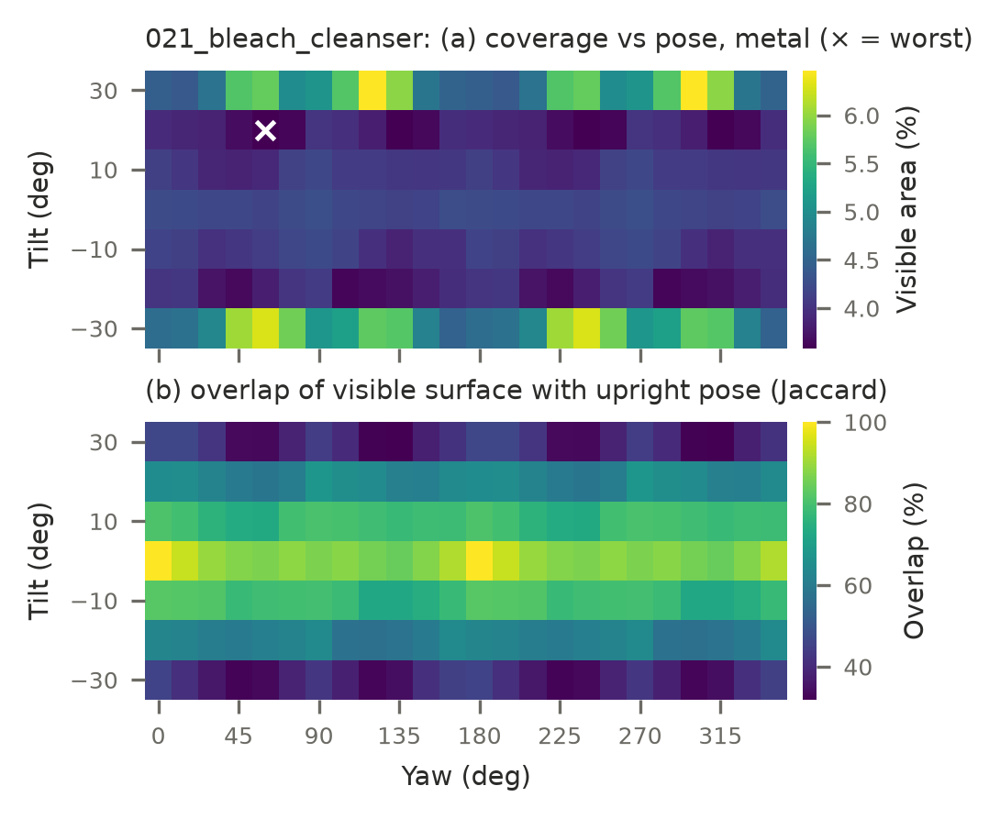
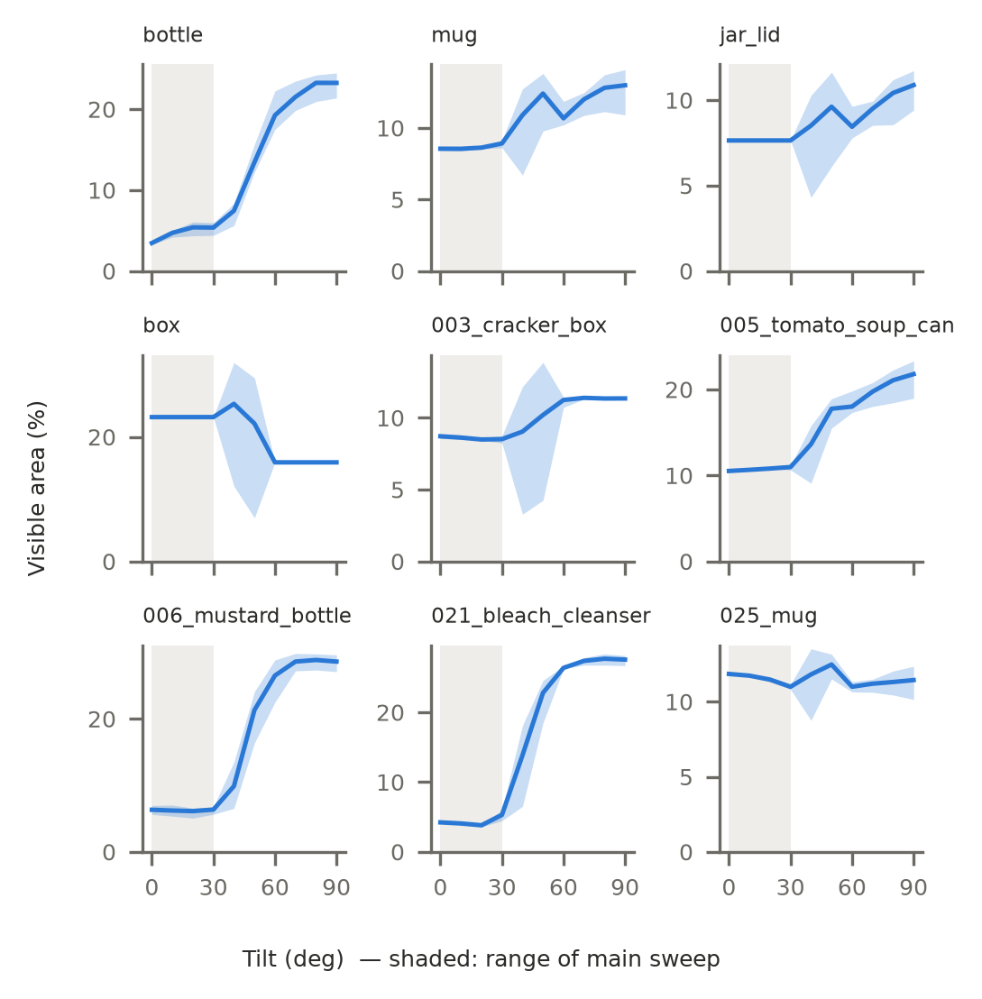
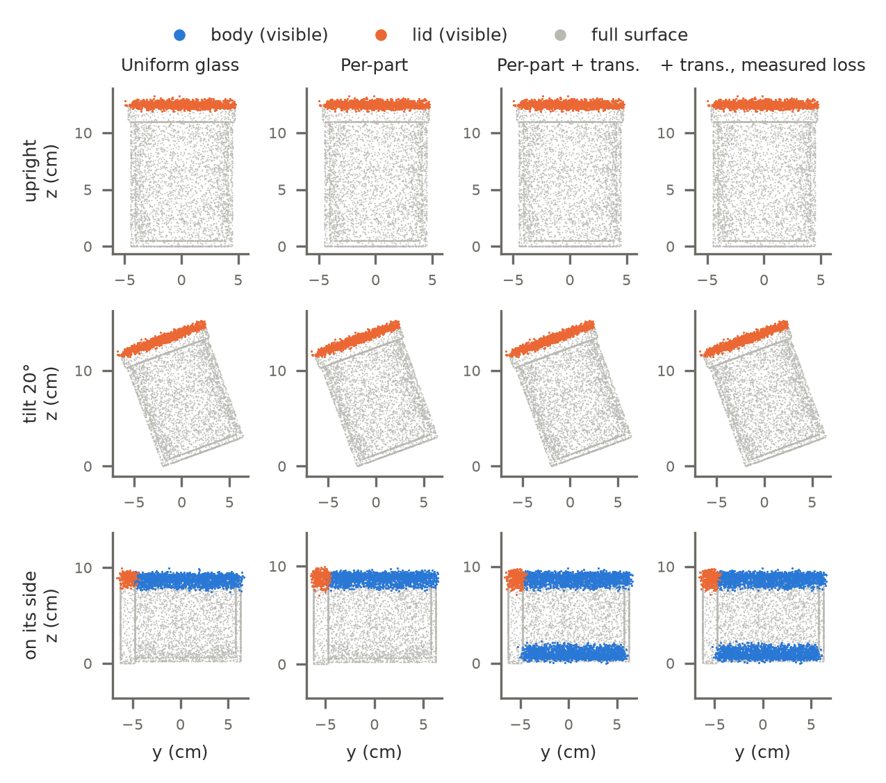
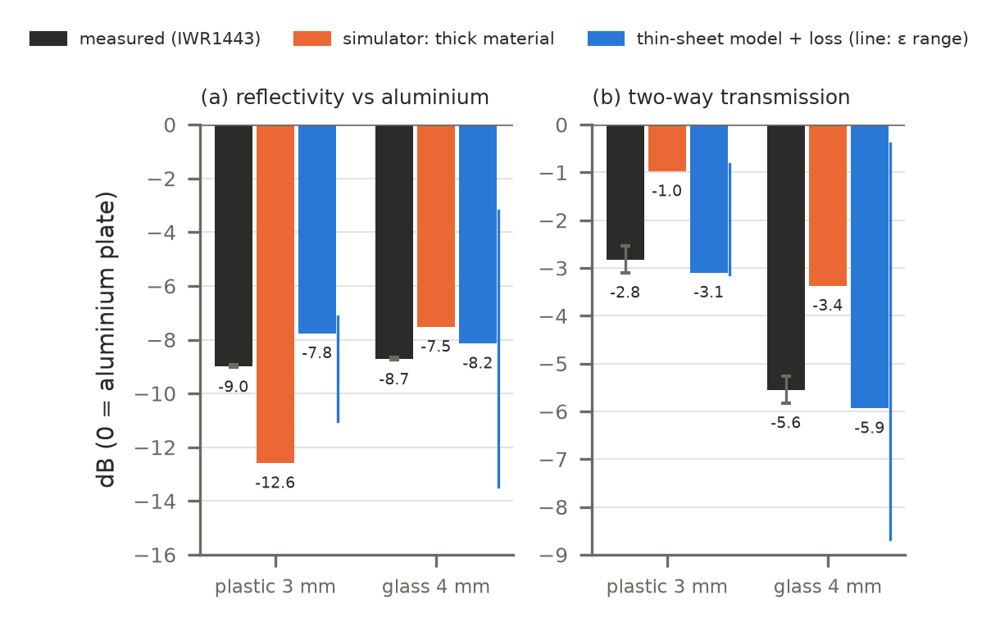

# Progress Report 1: Material- and Orientation-Aware Wave-Former

**MAS.S64 Wireless Sensing and Physical AI** · Siddharth Kulkarni, Ivan Wren · Oct 30
PDF to Fadel (fadel@mit.edu) and Nazish (nazishn@mit.edu) · target length 2–4 pages

> **How to use this file:** each section has the figures to place and bullet points of what to cover.
> The bullets are notes, not text: write the prose yourself. Every simulation result must be described as
> *our simplified geometric model inspired by Wave-Former's description, not Wave-Former's simulator*.
> More detail: `wf_sim/report_snippets.md` (captions, key numbers), `wf_sim/figures_guide.md` (how to read each
> figure), `wf_sim/hardware/MEASUREMENT_LOG.md` (every hardware session).
>
> **Page budget (suggested 6 figures):** pipeline diagram · setup photos · orientation heatmap · extended tilt ·
> jar partials · IWR validation. Everything marked *optional* goes in only if space allows.
>
> ⚠️ **Confirm before writing:** which sheet is glass and which is plastic in the photos (bluish-grey vs clear vs
> brown-papered), and whether the plastic still had its brown protective paper on during measurement.

---

## 1. Background & Motivation (~½ page, no figure needed)

Cover:
- **Problem:** mmWave sees through occlusions (boxes, bags), but reflections are mirror-like (specular), so a radar
  only sees the parts of an object facing it. Our simulator finds this is about **4–23 % of the surface**.
- **Wave-Former (Dodds et al.):** completes the full 3D shape from that partial view. It is trained **only on
  synthetic partial clouds**: keep radar-facing points, apply **randomized angle cutoffs to mimic materials**, add
  noise, train a PoinTr-style network.
- **Our question:** does that synthetic data miss things that matter in the real world?
  - **Proposal A (material-aware):** real objects mix materials (metal lid on a glass jar). One random cutoff per
    object can't represent parts that **block (metal) vs let the radar through (glass/plastic)**.
  - **Proposal B (orientation-robust):** real objects lie at arbitrary poses. The MITO real-world evaluation set
    (used by Wave-Former) is **mostly upright: 102 of ~136 capture poses are 0_0_0**.
- **Approach (one line each):** A = per-part materials in data generation → retrain → compare with the baseline and a
  random-material control. B = measure degradation vs yaw/tilt → retrain with randomized orientations.
- Keep it short; don't repeat the proposals.

---

## 2. Progress Made (~1 page)

### 2.1 Simulator (software)

*Optional, if space allows:* 

Cover:
- Built **`wf_sim`**, a simplified re-implementation of the partial-cloud generation stage described for
  Wave-Former. We don't have Wave-Former's code, and the network stage is not reproduced (grey boxes in the diagram).
- Visibility model:
  - 31 × 23 radar positions (60 × 45 cm aperture, 40 cm above the object)
  - a point is seen if its normal is within a cutoff angle of some radar position and the path is not blocked
    (ray casting)
  - 2 mm noise
- **Our extensions:**
  - **(A)** cutoff derived from **material physics** (Fresnel reflectivity → detection threshold) instead of random;
    **per-part** materials; optional **transmission** through glass/plastic (metal blocks)
  - **(B)** controlled **yaw/tilt** with fixed surface samples, so we can measure *which* surface is seen, not just how much
- **Objects:** 4 procedural (bottle + cap, hollow mug, hollow glass jar + metal lid, box) and **5 real YCB meshes
  from the MITO dataset** (cracker box, soup can, mustard bottle, bleach cleanser, mug).
- **Checks:** 15 automated tests (flat plate, sphere vs analytic, occlusion, material ordering, transmission,
  thin-sheet physics).
- **Code reading:** MITO's open-source simulator (same lab) uses a **fixed 5° specular threshold, no material
  term**, plus a separate edge model. Wave-Former code not available yet.

### 2.2 Hardware ground truth (IWR1443BOOST)

*(Collage of `Images/` photos: (a) radar, (b) TI Visualizer bring-up, (c) sheets, (d) distance test, (e) Exp. A,
(f) Exp. B. Individual photos are listed at the end of this file if you prefer different ones.)*

Cover:
- **Why:** the simulator's material behaviour came from textbook values. We wanted real measurements before building
  Proposal A on it.
- **Constraint:** only the IWR1443BOOST, **no DCA1000 capture board**, so no raw ADC data and no SAR imaging. We
  used the on-chip **range profile** (signal strength vs distance) from TI's demo firmware.
- **Built:** our own logger (decodes the radar's UART stream, labelled start/stop recordings, text log + raw
  profiles).
- **5 sessions:**
  1. sanity checks
  2. distance series (found saturation)
  3. TX power back-off
  4. **Exp. A:** reflectivity at 40 cm
  5. **Exp. B:** transmission (sheet at 40 cm, aluminium plate at 60 cm)
- **Samples:** 6 mm aluminium plate (metal reference), 4 mm glass, 3 mm plastic (acrylic-like); sheets 30.5 × 30.5 cm.
- Data quality: < 0.1 dB frame-to-frame noise, 0.1–0.6 dB drift over 5–6 min, background 35 dB below metal.

---

## 3. Initial Results (~1–1½ pages)

### 3.1 Orientation (Proposal B)

Cover:
- Sweep: 9 objects × 168 poses (yaw 0–345°, tilt ±30°), all metal.
- **Coverage barely changes** within ±30°: bleach 3.6–6.5 %, mustard 5.1–7.0 %, cracker box 8.1–8.9 %.
- **…but which surface is seen does:** overlap with the upright view falls to **39 %** at 30° tilt (bleach, mustard);
  soup can 84 %, cracker box 91 %. Panel (b) is the key evidence.
- Meaning: a model trained mostly on one pose gets unfamiliar inputs when the object leans.

Cover:
- Beyond 30°, coverage jumps: **mustard 6 → 29 %, bleach 4 → 28 %** lying down; the box goes the other way (23 → 16 %).
- **Upright is close to the worst case** for tall objects, and it's the pose most real MITO captures use.
- *Optional figures:* `wf_sim/figs/orientation_summary.png` (all objects at a glance),
  `wf_sim/figs/orientation_examples_021_bleach_cleanser.png` (what the partial clouds look like).

### 3.2 Per-part materials (Proposal A), simulation

Cover:
- Glass jar with metal lid, 4 conditions: uniform glass · per-part · per-part + transmission (ideal) ·
  per-part + transmission with **measured** glass loss.
- Upright / 20° tilt: only the lid is seen in every condition (the lid hides the opening; glass walls reflect away).
- On its side: per-part cutoffs change little (lid 6.6 → 7.3 %), but **transmission doubles the visible body
  (10.4 → 20.2 %)** by revealing the inner far wall. It **stays at 20.2 % with the measured glass loss**.
- *Optional:* `wf_sim/figs/material_jar_coverage.png` (the same numbers as bars).

### 3.3 Hardware validation (Proposal A)

Cover:
- **Reflectivity vs aluminium:** plastic 3 mm **−9.0 dB**, glass 4 mm **−8.7 dB**, nearly equal. The simulator's
  thick-material model predicted **5 dB apart** (−12.6 vs −7.5). A thin-sheet model (front/back interference)
  predicts both ≈ −8 dB ✓. This conclusion doesn't depend on the dB-scale calibration.
- **Transmission:** plastic **−2.8 dB**, glass **−5.6 dB** two-way, so both pass most of the signal (≈ 52 % / 28 % of
  power). The simulator assumed −1.0 / −3.4 dB (no absorption); thin-sheet + small loss matches (−3.1 / −5.9).
- → Added a thin-sheet + absorption model to the simulator code; used it to recalibrate the jar (result above).
- **Takeaway for A:** a wall's radar brightness and see-through-ness depend on **thickness and absorption** as much
  as on the material name. Per-part materials should carry thickness + loss.

### 3.4 What didn't work / what we learned

*(No figure, or optional `wf_sim/figs/fresnel.png` for the material background.)*

Cover:
- **Radar saturation:** a metal plate read ≈ 139 dB at every distance 40–120 cm. We caught it with a distance test
  and reduced TX power, but 18 dB of back-off lowered readings by only ~7 dB, so the **absolute dB scale is
  uncalibrated** (relative comparisons at the same setting are fine).
- Bring-up lessons:
  - Linux ModemManager grabs the radar's serial port
  - the demo needs a reset before re-configuring
  - config commands must be paced
  - hand-held targets add ±4 dB jitter
- **Yaw alone barely matters** for upright objects, so a turntable-only B experiment would show little. Tilt matters.
- **Per-part cutoff angles alone have a small effect;** blocking vs passing (transmission) is the bigger lever for A.
- Flat-topped objects (box, jar) are insensitive within ±30°; choose tall/curved objects.
- Our cutoffs (10–17°) are looser than MITO's 5°, so treat simulated coverage **trends** as the result, not exact percentages.

---

## 4. Outstanding Challenges (~½ page, no figure)

Cover:
- **No Wave-Former code/checkpoint:** we can measure input coverage, not reconstruction quality (Chamfer / F-score).
  Plan: request from course staff; fallback: train a small PoinTr baseline on our simulated partials.
- **No capture board (DCA1000):** no SAR images or real partial clouds. Plan: request lab-rig (UR5e + capture) time;
  keep using range-profile measurements for material physics.
- **Not yet validated:** angular falloff (H2; needs a turntable + same-size metal reference) and the absolute dB
  scale (planned: small-target distance test).
- **Thin walls in the generator:** the thin-sheet model exists but isn't yet used inside partial-cloud generation
  (needs a thickness per part).
- **Unknowns about Wave-Former's data generation:** orientation ranges, cutoff ranges, occlusion, evaluation
  alignment (listed in `wf_sim/pipeline_notes.md`). These decide how big each proposal's gap really is.
- (B) Real objects at large tilts need a stable tilting rig.

---

## 5. Next Steps & Timeline

*(Optional: a small table or Gantt-style list. Adjust with Ivan.)*

**By Nov 20 (Progress Report 2):**
- Thin-sheet (thickness + loss per part) inside the generator; rerun the jar and orientation experiments
- Hardware: 3D-printed turntable + same-size metal reference → angular falloff (H2); dB-scale check; more materials
  (PET bottle wall, PP container)
- Wave-Former access → answer the open questions; if a checkpoint is available, run it on our simulated partials:
  upright vs tilted (B), uniform vs per-part (A), giving the first **reconstruction-quality** numbers
- If no access: train a small PoinTr baseline on simulated partials
- (B) tilt + turntable rig; (A) collect mixed-material objects

**By Dec 7 (final presentation):**
- (A) retrain with per-part materials + transmission vs baseline vs random-material control
- (B) retrain with randomized orientations incl. large tilts; evaluate degradation vs pose
- Real scans on the lab rig if access allows; final presentation

---

## Appendix: available images

**Generated figures** (`wf_sim/figs/`):
- `pipeline_diagram.png`, `visibility_schematic.png`, `setup_photos.png`
- `fresnel.png`, `iwr_validation.png`
- `orientation_heatmap_<obj>.png`, `orientation_examples_<obj>.png`, `orientation_summary.png`,
  `orientation_extended_tilt.png`
- `material_jar_partials.png`, `material_jar_coverage.png`

**Photos** (`Images/`):

| File | Shows | Suggested use |
|---|---|---|
| `PXL_20261030_194914339.jpg`, `…194931781.jpg`, `…194944163.jpg` | IWR1443BOOST on its stand | radar close-up (collage a) |
| `…205342646.jpg` | radar + TI Visualizer range profile on screen | bring-up (collage b) |
| `…213901665.jpg`, `…213949571.jpg` | session 1: framed stencil as a target, tape measure | optional: first sanity check |
| `…215226771.jpg` (3 copies) | SMT stencil close-up | optional: "first metal target, retired" |
| `…221645099.jpg` | the three samples side by side | samples (collage c) |
| `…222135457.jpg` | aluminium plate on the table, radar behind | optional |
| `…224135741.jpg`, `…224142930.jpg`, `…224144224.jpg` | aluminium plate at distance, tape measure | distance / saturation test (collage d) |
| `…225544078.jpg` | sheet leaning on a box at 40 cm | Exp. A (collage e). ⚠️ confirm which sheet |
| `…231932962.jpg`, `…231934918.jpg` | clear sheet in front of the aluminium plate | Exp. B. ⚠️ confirm which sheet |
| `…232143096.jpg` | bluish sheet in front of the aluminium plate | Exp. B (collage f). ⚠️ confirm which sheet |
